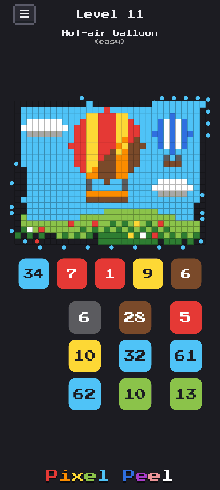
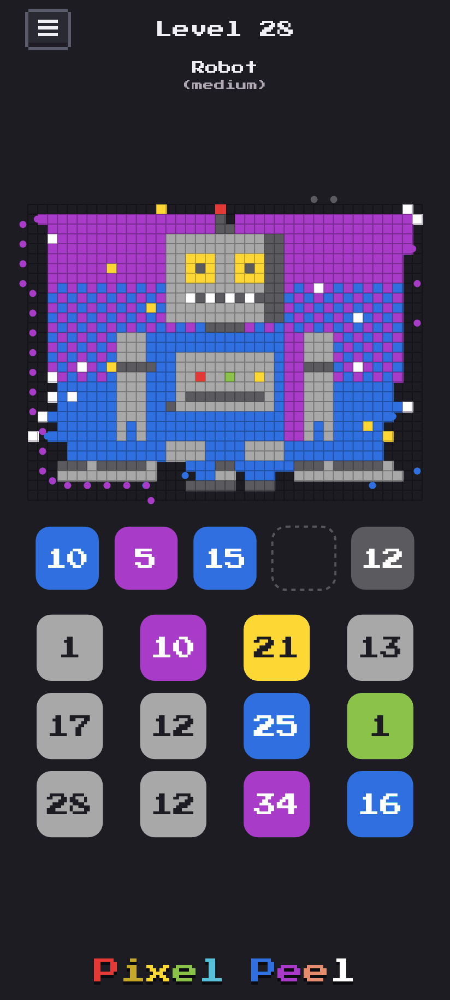
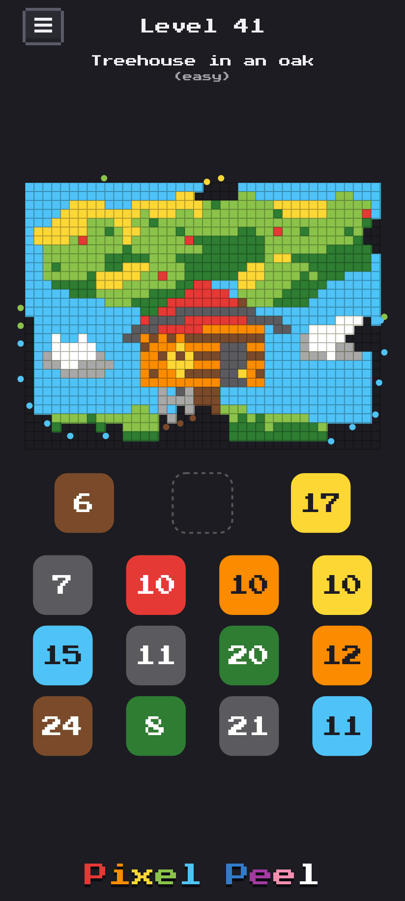
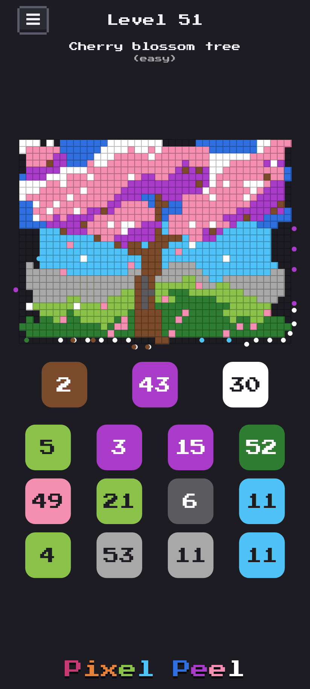

# Pixel Peel

A small puzzle in the browser. A pixel picture sits at the top of the screen, and little dots peel it apart,
one pixel at a time, colour by colour. You choose the order.

**Live: [pixelpeel.nilcaream.com](https://pixelpeel.nilcaream.com)**

## Screenshots

Four levels part way through, on a phone: Hot-air balloon (11), Robot (28), Treehouse in an oak (41) and
Cherry blossom tree (51).

  
  
  
  

## How to play

- Below the picture is a row of **buckets**, and below them are **columns of pots**. Each pot has a colour
  and a number, and the top three pots of each column are shown.
- Tap a column to move its top pot into a free bucket.
- Dots of that colour set off from the bucket. Each one walks around the outside of the picture, goes in
  through the squares that are already empty, flies to the most exposed pixel of its colour it can reach,
  and vanishes with it.
- The number on a bucket counts the dots still in it. When it reaches 0 the bucket is gone, and its place
  is free for the next pot at once.
- When only one column has pots left there is nothing to decide, so the game picks them itself and runs
  three times faster.
- A pixel that other pixels surround can't be reached. If every bucket holds a colour that no dot can reach,
  you are stuck: retry and try another order.
- Peel the whole picture to win and go on to the next level. Every level can be won.

Only the order of your picks matters, not when you make them: the same picks always play out the same
way. Your level and every pick you make are kept in the browser, so a reload goes on exactly where you
left off.

The menu (☰, over the picture's top left corner) plays any level you have peeled again, clears your
progress (tap twice), and links to this repository. The game's name is marked `translate="no"` where it
is spelled in coloured letters, so a browser that translates the page leaves it in one piece.

## Levels

- The pictures are scenes drawn in code (`src/scenes.ts`), in colours of one pool of clearly
  different colours (`src/palette.ts`). A scene fills its whole rectangle, gives each area two tones
  dithered together, and nests small things in big ones. At least three colours touch its edge, so no
  single colour is the only way in. Levels 1–20 are 32×24; from level 21 the scenes are 40×30, with room
  for shading, gradients, textures and scattered detail (a cell is still about 8 px on a 360 px phone).
- Levels come in waves: easy, medium, hard, with a very hard one every tenth level. Each block of ten
  levels is a step harder than the one before.
- Difficulty is measured on skill, not luck (`src/levels.ts`, `src/thinker.ts`). A casual player picks at
  random among the columns whose top pot can reach a pixel right now. A thinker looks a few picks ahead on
  the pots the page shows. A level's depth is how far ahead a thinker must look to win (90% of its games,
  85% on a very hard level), and its luck is what a thinker gains by seeing the hidden pots too:

  | band | levels 1–10: casual players win | depth | levels 11–20: casual players win | depth |
  |---|---|---|---|---|
  | easy | 80–98% | 1 | 65–85% | 1 |
  | medium | 50–80% | 1–2 | 35–65% | 2, and a depth-1 thinker wins at most 70% |
  | hard | under 50% | 2, and depth 1 wins at most 60% | under 30% | 2–3, and depth 1 wins at most 40% |
  | very hard | under 20% | 3, and depth 1 and 2 win at most 40% and 60% | under 10% | 4, and depth 1, 2 and 3 win at most 20%, 30% and 50% |

  | band | levels 21–30: casual players win | depth | levels 31–40: casual players win | depth |
  |---|---|---|---|---|
  | easy | 50–75% | 1 | 40–65% | 1 |
  | medium | 25–55% | 2, and depth 1 wins at most 60% | 20–45% | 2–3, and depth 1 wins at most 50% |
  | hard | under 25% | 2–3, and depth 1 wins at most 30% | under 20% | 2–3, and depth 1 wins at most 25% |
  | very hard | under 8% | 3–4, and depth 1 and 2 win at most 15% and 25% | under 6% | 3–4, and depth 1 and 2 win at most 10% and 20% |

  | band | levels 41–60: casual players win | depth | levels 61–70: casual players win | depth |
  |---|---|---|---|---|
  | easy | 30–55% | 1 | 25–50% | 1 |
  | medium | 12–35% | 2–3, and depth 1 wins at most 40% | 10–30% | 2–3, and depth 1 wins at most 35% |
  | hard | under 12% | 2–3, and depth 1 wins at most 20% | under 10% | 2–3, and depth 1 wins at most 15% |
  | very hard | under 4% | 3–4, and depth 1 and 2 win at most 10% and 15% | under 4% | 3–4, and depth 1 and 2 win at most 10% and 15% |

  | band | levels 71–80: casual players win | depth | levels 81 on: casual players win | depth |
  |---|---|---|---|---|
  | easy | 20–45% | 1 | 15–40% | 1 |
  | medium | 8–25% | 2–3, and depth 1 wins at most 30% | 6–20% | 2–3, and depth 1 wins at most 25% |
  | hard | under 8% | 2–3, and depth 1 wins at most 10% | under 6% | 2–3, and depth 1 wins at most 5% |
  | very hard | under 3% | 3–4, and depth 1 and 2 win at most 5% and 10% | under 3% | 3–4, and depth 1 and 2 win at most 5% and 10% |

  A scene may name the deal it is baked from (`deal` in `src/scenes.ts`), chosen from a sweep of the
  picture's deals for its band and for a game with no trivial first phase; the bake tries it first. A scene
  may also be an earlier level's picture drawn right to left (`mirror`), which plays as a picture of its own. A
  scene is drawn, dealt and played in the pool's letters only; it may be painted in an extended colour in place of a
  default one (`overrides`, e.g. charcoal painted navy), which changes how it looks and never how it plays. No picture
  shows more than four of the blue-greens (green, dark green, sky, teal, blue, navy).
  Pictures drawn but not yet levels wait in `src/portfolio.ts`.

  Every level has a luck of at most 5%, and a solver proves it can be won. When no deal of a picture fits
  its band, the level takes the closest deal and records what it misses (`misses` in `src/levels.json`): an
  outlier now and then is accepted on the way to a hundred levels.
- `npm run bake` makes `src/levels.json` offline (`scripts/bake.ts`, one worker per level). A baked level's pots
  are the level: it is kept as stored while its scene draws the same squares, and a scene drawn in other letters
  relabels it (the same pots, numbered by the new letters), so a recolour never changes how a level plays. Only a
  new level, one whose squares changed, or one named (`npm run bake -- 21 22`) is dealt. For each of those it
  deals pots that are known to win and perturbs them (pots surface early, the order is turned round, pots
  merge). It measures the deal, the cheapest measure first, and turns the knobs in this order: the strength
  of the perturbing, then fewer buckets (5, 4, 3), then the scene's next seed. When that search finds no deal,
  a grid tries every bucket count and strength, a few deals each. A deal is kept when its casual share is inside
  the band by a margin (one standard error above the bottom edge, two below the top, since a level too easy is the
  worse miss), and games the bake did not choose it on (casual games 201–400, thinker games 21–40) keep it in the
  band. Levels 1–90 were baked before that rule and stay as they were. Each level keeps its seeds,
  strength, measures and the solver's winning order, which a test replays. `npm run bake -- --check` fails when
  the committed file is not what `npm run bake` would make; `npm run bake -- --judge [21 22]` judges stored levels
  again under the rules as they are now and writes nothing.
- New levels are designed with the tools in `scripts/design/`, which write under `out/` (not committed). The
  order is pictures first, then deals, then bands and order:
  - `npm run design:preview` draws the portfolio to PNGs and measures each picture before any deal. It reports
    how much one colour peels at the start, how much filler is peeled outside the subject, the subject's share,
    rounds, groups and patterns. `dump=N` prints a picture's letters.
  - `npm run design:deals -- run 61,62` deals a picture over buckets × strength × seed and measures each deal.
    The run is resumable. It can also take a level's picture mirrored, or add deals where a band is close.
  - `npm run design:reach -- out/deals/*.jsonl` shows which bands each picture reaches, and its best deal per band.
    `npm run design:order -- 60 90 …` then finds an order for a run of levels under `ruleFor`.
    `npm run design:gallery -- out/order.json` draws every level in order.
  - `npm run design:rows -- dump|check` holds the pictures to their letters across a change to the drawing code.
  - `npm run design:palette -- near|search|census|check|recolour` is for choosing and checking colours.
  - `npm run design:pressure -- measure 60-90`, then `-- table`, measures what a level asks of a player's nerve
    and gives away: picks that hold a bucket because their colour cannot be reached yet, the free buckets left
    at each pick, and runs of picks down one column that each lift pixels, along the solver's line and in the
    play of the sensible player, a player who keeps to one column, and the thinker.
- Dev mode is for trying levels. The menu offers it, as a button that is green while on, only when the
  page is served on a port above 5000 (for example `npm run dev`, or a preview on the LAN), never on the
  site's default port. Once it is on, it stays on there: the band under the level's name shows the level's
  depth and casual win rate, as "(hard d3 13%)", and a tap on the left or right third of the picture opens
  the level before or after. On such a port, `?level=N` opens level N.

## Development

- `npm ci`, then `npm run dev` (dev server on 127.0.0.1), `npm test` (Vitest), `npm run typecheck`,
  `npm run build` (type check, then `vite build` into `dist/`), `npm run preview`.
- The rules are in `src/rules.ts`, a logical model with no time in it: `pick()` takes a board and settles
  everything that follows at once, so a game's outcome depends only on the order of the picks.
  `src/scene.ts` animates what the rules decided, with dots on a tick. `src/generator.ts` deals,
  perturbs and measures a level's pots on the rules, and `src/bake.ts` keeps the deals that fit a band.
  `src/main.ts` draws the scene on a canvas, `src/progress.ts` is the player's progress, and `src/keep.ts`
  keeps it with the solve log in IndexedDB.
- The icons are the Cactus level's scene made square, with a few more rows of its sky above and its sand
  below (`src/logo.ts`). They are made by `python3 -I scripts/make-icons.py` (Pillow).
- Every push to `main` builds, tests and publishes `dist/` to GitHub Pages
  (`.github/workflows/pages.yml`). The site is at a domain root, pixelpeel.nilcaream.com, so Vite's
  `base` is `/` and the manifest and icons are linked by absolute path.
- The version is `package.json`'s, shown in the menu with its `releaseDate` beside it; both are set at each
  release, so a build is the same whenever it is made.
- Offline and updates: the build has a service worker, `src/sw.ts`, built as `/sw.js`. Once the build is
  written, a plugin in `vite.config.ts` fills in the list of the build's files (`src/precache.ts`), so each
  new build is a new `sw.js`. The worker keeps the build and serves it, so the game opens offline.
  - The page asks for a newer build each time it comes back to the screen (`src/update.ts`). A newer build
    takes over at once.
  - The page reloads onto it only when that loses nothing: nothing picked since the level opened, the page
    out of sight, or Next or Retry.
  - Every step fails silently. The dev server runs without the worker.

## Licence

MIT, see `LICENSE`. The font, Press Start 2P by The Press Start 2P Project Authors (Reserved Font Name
"Press Start 2P"), is under the SIL Open Font License 1.1 and ships unmodified: see `public/fonts/OFL.txt`,
which is published beside the font.
